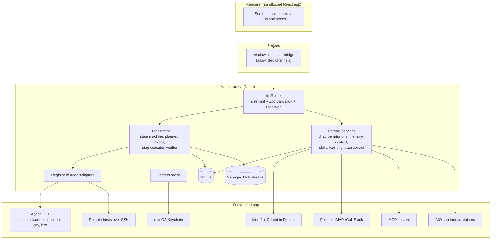
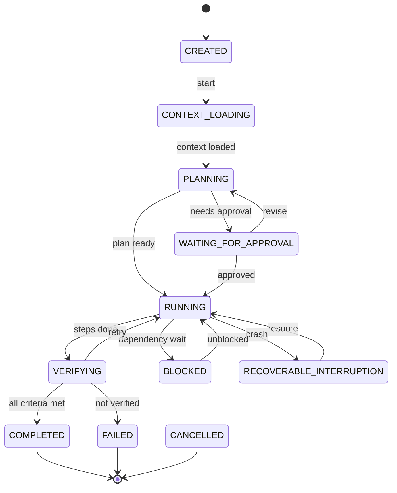

# Conductor Architecture

Conductor is a local-first macOS desktop app (Electron + React + TypeScript) that plans, runs, and reviews work across several AI coding CLIs (Codex, Claude Code, OpenCode, Antigravity, Kiro, Command Code, and remote hosts). Conductor does not run models itself. It wraps the CLIs already installed on the machine in a durable, permission-gated, auditable orchestration layer.

This document describes how the system is put together and why. For setup and usage see [README.md](README.md).

## Contents

1. [System overview](#1-system-overview)
2. [Process and module boundaries](#2-process-and-module-boundaries)
3. [Composition root and dependency wiring](#3-composition-root-and-dependency-wiring)
4. [IPC layer](#4-ipc-layer)
5. [Task orchestration](#5-task-orchestration)
6. [Agent adapters](#6-agent-adapters)
7. [Routing and model selection](#7-routing-and-model-selection)
8. [Permissions and tool approvals](#8-permissions-and-tool-approvals)
9. [Secrets handling](#9-secrets-handling)
10. [Trusted vs. untrusted data](#10-trusted-vs-untrusted-data)
11. [Persistence](#11-persistence)
12. [Context, memory, and Mem0](#12-context-memory-and-mem0)
13. [Connectors and data control](#13-connectors-and-data-control)
14. [MCP integration](#14-mcp-integration)
15. [Chat, Work threads, and git worktrees](#15-chat-work-threads-and-git-worktrees)
16. [Skills, workflows, and learning](#16-skills-workflows-and-learning)
17. [Sandbox agents and flows](#17-sandbox-agents-and-flows)
18. [Phone control](#18-phone-control)
19. [Renderer architecture](#19-renderer-architecture)
20. [Build, test, and delivery](#20-build-test-and-delivery)
21. [Key design principles](#21-key-design-principles)

---

## 1. System overview



The code is split into four top-level source trees:

| Path | Role |
| --- | --- |
| `src/main/` | Electron main process. Orchestration, adapters, storage, connectors, IPC handlers. All privileged work lives here. |
| `src/preload/` | The only bridge between the sandboxed renderer and main. |
| `src/renderer/` | React UI. No Node access. |
| `src/shared/` | Types, Zod schemas, and contracts imported by all three. This is the single source of truth for IPC shapes and domain types. |

Outside `src/`: `services/mem0/` (optional memory service), `test/` (Vitest), `electron-builder.yml` and `electron.vite.config.ts` (build).

## 2. Process and module boundaries

The window is created in `src/main/index.ts` with a deliberately hardened configuration:

- `contextIsolation: true`, `sandbox: true`, `nodeIntegration: false`, `webSecurity: true`.
- `setWindowOpenHandler` denies new windows, and `will-navigate` only permits the application URL (`navigation-policy.ts`). External `http(s)` links open in the system browser.
- A strict Content-Security-Policy is injected into `index.html` at build time (`electron.vite.config.ts`). Production is `'self'` only. Development relaxes just enough for Vite's HMR.

**Why it matters:** the renderer renders model output, Markdown, HTML visuals, and Mermaid diagrams, all of which may contain hostile content. Treating it as untrusted and giving it only a narrow, validated API contains the damage if it is compromised.

**Preload constraint:** the sandboxed preload can only `require` `electron` and Node built-ins. It must not import anything that pulls in `zod` or another npm package. For that reason the runtime list of event channels lives in `shared/event-channels.ts`, which has no dependencies. `ipc-contract.ts` re-exports it.

## 3. Composition root and dependency wiring

`src/main/bootstrap.ts` is the composition root. It opens the SQLite store, runs migrations, constructs every service, injects dependencies, registers IPC handlers, and returns an `AppServices` object. `index.ts` then creates the window and hands the live `WebContents` resolver to the event emitters.

Conventions that follow from this:

- **Constructor injection everywhere.** Services take their collaborators (store, audit log, clock, transports) as parameters. There is no global state or service locator.
- **Seams for side effects.** Anything that touches the outside world sits behind an injectable interface, for example `RemoteTransport` (SSH), `McpTransport`, `SecretResolver`, `CommandRunner`, and `CliEnvironment`. Tests substitute fakes (`test/fakes/`) and drive full lifecycles without real CLIs, hosts, or servers.
- **Emitters resolve the window lazily** (`setWebContentsResolver`), so they survive window recreation on macOS `activate`.

## 4. IPC layer

Files: `src/main/ipc/router.ts`, `src/main/ipc/register-*.ts`, `src/shared/*-contract.ts`, `src/preload/index.ts`.

**Renderer to main (invoke).** Every handler is registered through `IpcRouter.handle(channel, zodSchema, handler)`, which wraps it in `withValidation`:

1. Reject payloads over 1 MiB before parsing (cheap DoS guard).
2. Parse with the channel's Zod schema. On failure, return a typed error and never run the handler.
3. Run the handler and wrap the result as `{ ok: true, value }`.
4. Convert thrown errors into `{ ok: false, error: { code, message } }`.

Channels outside the allowlist are dropped and the attempt is audited. The preload's `invoke` helper unwraps `IpcResult` and throws a plain `Error` named `IpcError:<code>`, so renderer code can use ordinary `try/catch`.

**Main to renderer (events).** Only channels in `EVENT_CHANNELS` can be emitted (`task.updated`, `task.stream`, `chat.updated`, `approval.requested`, `question.requested`, `resume.snapshot`, `audit.appended`, `dataflow.external`, `suggestion.surfaced`, `connector.updated`, and others). Payloads are redacted before they leave main (`ipc/redaction.ts`). Event-specific emitters (`IpcTaskEventEmitter`, `IpcChatEventEmitter`, `IpcConnectorEventEmitter`, and others) implement small interfaces that the orchestrator and services depend on, so those services never import Electron.

**Contracts are grouped by domain** (`chat-contract`, `connector-contract`, `knowledge-contract`, `automation-contract`, `github-contract`, `integrations-contract`, `icon-contract`, ...). Each exports its Zod schemas plus a typed bridge interface. Handler registration is split the same way (`register-chat.ts`, `register-connectors.ts`, `register-knowledge.ts`, and so on).

## 5. Task orchestration

Files: `src/main/orchestrator/`.

A **task** is one unit of agent work: an objective, acceptance criteria, a workspace, and an ordered set of steps. The orchestrator turns it into a durable, resumable execution.



(Every non-terminal state can also reach `CANCELLED` and `FAILED`; those edges are omitted from the diagram for readability.)

### State machine (`state-machine.ts`)

- 11 states: `CREATED`, `CONTEXT_LOADING`, `PLANNING`, `WAITING_FOR_APPROVAL`, `RUNNING`, `VERIFYING`, `COMPLETED`, `FAILED`, `BLOCKED`, `CANCELLED`, `RECOVERABLE_INTERRUPTION`.
- `TRANSITION_TABLE` is the **only** authority on legal transitions. Illegal transitions are rejected, the task is left untouched, and an audit event is appended.
- `transition()` is **write-ahead**. The transition event, the new task state, and a checkpoint commit as one atomic DB unit *before* any side effect of the new state runs. If the commit fails, the task stays in its prior state and no side effect happens.
- `COMPLETED`, `FAILED`, and `CANCELLED` are terminal.

### Lifecycle pieces

| Module | Responsibility |
| --- | --- |
| `orchestrator.ts` | Lifecycle entry points: `createTask` (validate, persist in `CREATED`), `beginExecution` (load context, then plan), `planTask` (decompose, topologically sort, route, persist). |
| `planner.ts` / `plan/agent-planner.ts` | A `Planner` seam that decomposes an objective into a DAG of steps. Cycles are rejected (`PlanCycleError`) and nothing is persisted. The agent-backed planner drops in behind the same interface. |
| `routing.ts` | Deterministic step-to-adapter routing (see [section 7](#7-routing-and-model-selection)). |
| `step-executor.ts` | Runs routed steps in dependency order. Streams adapter events, checkpoints every consumed event, enforces step permissions, retries with backoff, and skips already-succeeded steps on resume. |
| `verifier.ts` | Decides whether a task may become `COMPLETED` (see below). |
| `cancellation.ts` | Cancels a task: transition to `CANCELLED` first, then signal every in-flight session. Sessions that do not acknowledge within 30 seconds are force-terminated and the kill is audited. |
| `resume-center.ts` | Boot-time reconciliation (see below). |
| `resume-service.ts` | Executes the user's Resume, Inspect, Restart, and Discard choices. |
| `task-runner.ts`, `task-queries.ts` | Application-level task execution wiring and read models for the UI. |
| `thread-context.ts` | Builds conversation history and resume targets so a thread stays pinned to its originating agent and provider session. |
| `tool-approvals.ts`, `agent-questions.ts` | Brokers that park a pending approval or agent question until the UI answers. |

### Verification: no false completion

An adapter exit code of 0 is **never** sufficient. A task becomes `COMPLETED` only after the verifier records **every** acceptance criterion as satisfied. The `COMPLETED` transition writes a `VERIFIED` checkpoint that references the verification outcome. Evaluation is bounded by a 300-second budget and runs through an injectable `CriterionEvaluator` seam (`evidence-evaluator.ts`).

### Crash recovery: the Resume Center

On every launch, `ResumeCenter.onBoot()` loads all non-terminal tasks and reconciles persisted state against reality:

- It probes each adapter session for liveness (`probeLiveness`) and marks it live, exited, or orphaned.
- It checks that artifacts referenced by the last checkpoint still exist in managed storage.
- It classifies each task as `RESUMABLE`, `RECOVERABLE_INTERRUPTION`, or `BLOCKED`. The classification is a deterministic function of persisted state plus observed liveness.

The UI then offers Resume, Inspect, Restart, or Discard. Resume never re-executes a step already marked `succeeded`. Re-running a consequential, destructive, external-communication, or financial step requires explicit confirmation.

## 6. Agent adapters

Files: `src/shared/adapter.ts`, `src/main/adapters/`, `src/main/registry/registry.ts`.

`AgentAdapter` is the single pluggability seam. Local CLIs, model providers, local tools, computer-interaction drivers, and remote hosts all implement the same interface, so the orchestrator is agent-agnostic.

```ts
interface AgentAdapter {
  record: AdapterRecord;                       // class, capabilities, permission requirements
  probeLiveness(session): Promise<boolean>;
  start(input): Promise<AdapterSessionHandle>;
  stream(handle): AsyncIterable<AdapterStreamEvent>;   // ordered, checkpointed
  await(handle): Promise<AdapterResult>;
  cancel(handle): Promise<void>;
  resume?(session): Promise<AdapterSessionHandle>;     // optional
}
```

Adapter classes: `local_cli_agent`, `model_provider`, `external_service`, `local_tool`, `computer_interaction`, `remote_execution`.

The **Registry** catalogs adapters, resolves them by id, probes liveness, and answers "which adapters declare capability X?". It rejects any adapter with an incomplete contract, so such an adapter can never be routed to.

### Concrete adapters

| Adapter | How it drives the agent | How it asks for approval |
| --- | --- | --- |
| `codex-app-server-adapter` | `codex app-server` (JSON-RPC over stdio). Notifications are translated into the `codex exec --json` shape. | Answers Codex's approval requests itself. |
| `claude-code-adapter` | `claude -p` in print mode. | `--permission-prompt-tool` pointing at an MCP tool on the loopback approval bridge. |
| `acp-agent-adapter` | Agent Client Protocol (JSON-RPC over stdio) for OpenCode and Kiro. | `session/request_permission`. Conductor injects config so OpenCode asks for everything except reads and searches. |
| `antigravity-adapter` | Antigravity CLI. | A `PreToolUse` hook that calls the approval bridge. |
| `local-cli-adapter`, `objective-cli-adapter` | Generic child-process CLI: PATH discovery, ordered stdout/stderr events, SIGTERM then SIGKILL, pid-based liveness. | n/a |
| `remote-execution-adapter` + `ssh-transport` | Connects to a remote host over the system OpenSSH client (`BatchMode`, so it never prompts), bootstraps the harness if missing, and drives it through the identical contract. | Same as the underlying harness. |

`gated-agent-adapter.ts` is the shared base class for CLIs that ask before each tool call. It owns the process, event stream, tool gate, and cancellation. Subclasses only build the launch and parse output.

`approval-bridge.ts` is a loopback HTTP server with a random token per agent session. It exposes `POST /s/<token>/hook` (Antigravity) and `POST /s/<token>/mcp` (Claude Code's permission tool, answered over SSE with keepalives because approvals can take minutes). A caller that learns a token can only *ask* the user, never approve anything itself.

`failure-classification.ts` sorts failures (quota, auth, model-not-found, and so on) and decides whether a retry on another agent is sensible.

## 7. Routing and model selection

**Which adapter** (`orchestrator/routing.ts`). `selectAdapters` is a **pure function**: no I/O, no clock, no unordered iteration. For each step it:

1. asks the Registry for adapters declaring the required capability,
2. keeps those that are available and whose permission requirements are satisfiable under the active profile,
3. picks exactly one using a fixed precedence (task fit, availability, cost, latency, permission satisfiability, historical performance, then the shared agent preference order) with a lexicographic tiebreak on adapter id.

If nothing qualifies, the step uses a deterministic fallback automation when one was supplied. Otherwise it is marked `BLOCKED`. Identical inputs always give identical routing, which makes behavior reproducible and testable.

The shared preference order is in `shared/agent-preference.ts`: `opencode, codex, claude-code, antigravity, kiro`.

**Which model and effort** (`main/agents/`):

1. The composer's per-message choice wins.
2. Otherwise Settings > Agent models.
3. Otherwise **Auto**: `assessDifficulty` (a free, deterministic estimate, or the planner's rating) maps quick questions to an agent's economy model at low effort and large builds to its premium model.

`model-catalog.ts` reads each CLI's available models. `run-resolver.ts` applies the order above. `context-budget.ts` caps the context handed to an agent.

**Fallback.** When one CLI runs out of usage or fails in a retryable way, chat and sandbox agents fall through to the next compatible candidate (`chatFallbackCandidates`).

## 8. Permissions and tool approvals

Files: `domain/permission-service.ts`, `adapters/tool-gate.ts`, `orchestrator/tool-approvals.ts`.

Three **permission profiles** are granted to a subject (an agent id or a workflow id):

| Profile | Behavior |
| --- | --- |
| `read_only` | Nothing may change. Consequential requests are declined without asking. |
| `assisted_execution` | Consequential actions need an approval from the user. |
| `trusted_automation` | Accepted without asking, within granted scope. |

How each profile is enforced depends on the CLI. For example Codex runs in a read-only or workspace-write sandbox with an approval policy, and Claude Code under `read_only` is limited to Read, Glob, and Grep.

Other rules:

- **Approval requests** move `pending` to `approved`, `denied`, or `expired`. They time out after 24 hours and leave the task in `WAITING_FOR_APPROVAL`. Permissions are re-checked at approval time.
- **Revocation** cancels dependent in-flight actions and blocks later ones.
- **Routing is permission-aware.** An adapter whose requirements cannot be satisfied is never selected.
- Every privileged operation appends a redacted audit event.
- The **audit log** (`domain/audit-log.ts`, table `audit_events`) is append-only.

## 9. Secrets handling

Files: `src/main/secrets/`, `src/shared/secrets.ts`.

- Real secret values live **only in the macOS Keychain** (service `Conductor`, account = secret id). SQLite stores metadata only: id, label, owner.
- `SecretStore` writes through `/usr/bin/security -i`, sending the value hex-encoded on stdin so it never appears in a process argument list.
- Adapters, connectors, and the orchestrator hold only `{{SECRET:id}}` **placeholders**. Adapters assert their launch input contains no raw secret before spawning.
- `SecretsProxy` is the single egress choke point. At the moment of a request it checks an ownership/permission gate, resolves the placeholder via `KeychainSecretResolver`, sends the request, and discards the value. Resolution happens after all logging, audit, and persistence steps for that request have completed.

This design makes secret leakage into logs, checkpoints, prompts, or the renderer structurally hard, rather than relying on every call site to behave.

## 10. Trusted vs. untrusted data

File: `orchestrator/data-channel.ts`.

The orchestrator is driven by one channel of **trusted instructions**: the objective, acceptance criteria, and system configuration authored by the user and Conductor. Everything it *ingests* (emails, web pages, files, tool output, prior agent output) is **untrusted**.

- `TrustedInstruction` and `UntrustedData` are distinct branded types with no conversion between them. Ingested content cannot be passed where an instruction is expected, and the two cannot be concatenated into either channel.
- `revealForDisplayOnly` is the only way to read untrusted content back out, and it never yields a trusted instruction.
- `scanForInjection` detects text that tries to override or reveal instructions. The text is ignored and the attempt is audited as *ignored*.
- Skills attach their bodies and extracted values to prompts as `untrusted_reference_data`, with only a short Conductor-authored instruction on top.

This is the prompt-injection defense: mixing the two channels is made a type error.

## 11. Persistence

Files: `src/main/db/`, `src/main/storage/managed-storage.ts`.

**SQLite** (`better-sqlite3`, WAL mode, foreign keys on) holds relational data and workflow state.

- **Migrations** (`db/migrations/index.ts`) are forward-only, versioned, and must form a gapless `1..N` sequence (checked in the constructor). Each step runs in its own transaction and bumps `schema_version` in that same transaction, so a failed step leaves the version untouched and the app can refuse to run against a half-migrated database.
- The store supports consistency-checked backup and restore.
- Main table groups:

| Group | Tables (examples) |
| --- | --- |
| Workspaces and settings | `workspaces`, `preferences`, `active_workspace` |
| Governance | `audit_events`, `permission_grants`, `approval_requests`, `external_flow_consents` |
| Task execution | `tasks`, `task_steps`, `checkpoints`, `task_events`, `agent_sessions`, `task_plans`, `task_message_queue` |
| Context and memory | `context_items`, `context_provenance`, `memories`, `memory_provenance_events`, `mem0_namespace`, `mem0_deletions` |
| Workflows and skills | `workflows`, `workflow_runs`, `workflow_step_history`, `skills`, `skill_versions`, `skill_bindings`, `skill_usages` |
| Connectors | `connectors`, `ingested_items`, `mcp_servers`, `mcp_exposed_capabilities`, `secrets`, `remote_hosts` |
| Learning and proactivity | `task_outcomes`, `improvement_proposals`, `suggestions`, `auto_execute_rules` |
| Chat | `chat_threads`, `chat_messages`, `chat_spaces`, `chat_usage`, attachment link tables |
| Usage | `agent_usage`, `agent_usage_limits` |
| GitHub | `github_pull_requests` |
| Sandbox agents and flows | `sandbox_agents`, `agent_groups` and related, `agent_flows`, `agent_flow_runs`, `agent_flow_run_nodes` |

**Managed local storage** keeps large artifacts, logs, and documents as blobs on disk, sharded by the first two hex characters of their id. Database rows reference blobs by id, which keeps SQLite small. The Resume Center uses these references to detect filesystem drift.

## 12. Context, memory, and Mem0

Files: `domain/context-engine.ts`, `domain/memory-engine.ts`, `domain/mem0-client.ts`, `services/mem0/`.

Two cooperating engines, both built around **veracity** and **provenance**:

- **Context Engine** models active work across five scopes (global, project, task, workflow, source). Each item has a veracity (`observed_fact`, `inferred`, `unverified_assumption`), a confidence in [0, 1], and at least one provenance source. A sourceless item is forced to `unverified_assumption` at confidence 0.
- **Memory Engine** holds durable knowledge across four layers: personal, project, task, and procedural. It enforces that a new memory which contradicts or duplicates an old one **supersedes** it (with pointers and provenance events on both sides), and that expired or superseded memories are never returned.
- **No silent fact elevation.** Veracity moves up to `observed_fact` only through an explicit user correction or a verification event, and each promotion records its trigger.

**Mem0** is the optional semantic store. `services/mem0/` is a small FastAPI wrapper around the Mem0 SDK, run with Qdrant under Docker Compose. It binds to `127.0.0.1:8000`, requires an API key, and computes embeddings locally with FastEmbed (`BAAI/bge-small-en-v1.5`). `Mem0Client` is the TypeScript client. Mem0 owns content and semantic ranking, while SQLite keeps the relational metadata (layer, project, provenance, supersession). The UI shows a notice when Mem0 is offline, and the app works without it.

## 13. Connectors and data control

Files: `src/main/connectors/`, `domain/data-control-service.ts`.

Connectors ingest outside context into Conductor: **folders**, **IMAP email**, **iCalendar**, and **Slack**.

- `ConnectorService` persists connector state. `IngestionWorker` performs one sync. `ConnectorRuntime` decides *when* syncs happen: user actions, a debounced recursive file watcher per folder, and a periodic sweep. It also prevents overlapping syncs.
- Background sync runs only while the user's `syncEnabled` preference is on (the default is **off**). User-initiated syncs always run.
- Ingested items flow through `memory-ingestion-sink.ts` into the Context and Memory engines, carrying provenance.
- **Two gates guard every network connector** (`network-access.ts`): (1) per-provider user consent, and (2) the `SecretsProxy`, which injects credentials only at egress and only for the connector that owns them.
- **Data control** is the choke point for external transmission. `beginExternalFlow` blocks flows to providers without consent, and for permitted flows emits `dataflow.external` to the UI within 500 ms so the user can see data leaving the machine. It never carries the transmitted content. Retention, indexing, and sync settings are stored under the `data.*` preference namespace with local-first defaults.

## 14. MCP integration

Files: `src/main/mcp/`.

- `McpRegistry` owns the control plane: discovery, validated registration, 60-second health checks, request timeouts with cancellation, access control, and an audit event for each lifecycle operation. Only the injected `McpTransport` (`sdk-transport.ts`, built on `@modelcontextprotocol/sdk`) touches a real server.
- **Safety invariant:** a newly added server is `untrusted` and `disabled`. It is neither launched nor contacted until a user approves it, which flips it to `trusted` and enabled. Calls to unapproved servers are rejected with `not_approved`.
- `McpService` is the user-facing layer: add, approve, health, and handing approved servers to agent runs. `mcp-oauth.ts` handles OAuth, including GitHub device flow. `marketplace-catalog.ts` and `shared/mcp-marketplace.ts` provide discovery.
- `CliMcpManager` (`cli-mcp.ts`) manages the MCP servers inside each agent CLI's *own* config. Reads come from the CLI, and writes go through each CLI's own `mcp add` / `mcp remove`, so file formats stay valid. Optional add-only sync copies a server to other installed CLIs, and deliberate removals are remembered so sync does not re-add them.

## 15. Chat, Work threads, and git worktrees

Files: `domain/chat-service.ts`, `ipc/register-chat.ts`, `domain/worktree.ts`, `domain/workspace-*.ts`.

Two interaction modes sit on the same machinery:

- **Chat** (`ChatService`): conversational threads, optionally grouped into **spaces**. Each thread is pinned to the agent and provider session that started it. Messages carry attachments, usage is recorded per message, and failures can fall back to another agent.
- **Work**: threads that run planned tasks through the orchestrator against a project workspace.

**Worktree isolation.** Every Work thread runs in its own **git worktree**, created before the agent starts, on a branch like `conductor/<id>`. Worktrees live beside the project (`<parent>/.conductor-worktrees/<repo>-<thread>`) and never inside it, so the main checkout stays clean. Agent changes reach the user's checkout only when they merge the thread branch. Non-Git folders run in place. `workspace-changes.ts` computes diffs for the UI, and `github-service.ts` and `pr-description.ts` support pull-request workflows.

**Attachments** (`src/main/attachments/`). Files are stored through a managed flow. PDFs are text-extracted locally, with on-device macOS Vision OCR when a page has no embedded text. Agents get a manifest of bounded extracted text plus the CLI's native input flag (`--image` for Codex, `--file` for OpenCode). The renderer never sees filesystem paths. Limits: 10 files per message, 25 MiB per file, 250 MiB per message, 40,000 extracted characters.

## 16. Skills, workflows, and learning

**Skills** (`skills-service.ts`, `skill-trigger-service.ts`, `skill-authoring-service.ts`, `orchestrator/skill-orchestration.ts`). Versioned, learned procedures bound to contexts such as a vendor. Before a step runs, recognition checks whether an active binding matches. A match resolves the current skill version and applies its template (the invoice flow extracts fields and compares them with a purchase order). The result is attached as *untrusted reference data*. Usage is recorded in `skill_usages`.

**Workflows** (`workflow-engine.ts`, `workflow-graph.ts`). User-defined DAGs with versioning that retains prior versions. Graph validation rejects cycles, dangling or duplicate ids, and graphs over 500 steps. Execution honors bounded loops, retry and timeout policies, and an error-recovery policy, through an injectable step-runner seam.

**Self-learning** (`self-learning-service.ts`, `learning-loop.ts`, `learning-analyzer.ts`, `learning-cron.ts`):

1. Every finished task records an outcome (duration, failures, retries, criteria, agents used). The history is append-only.
2. A candidate improvement is classified as *demonstrated* only if it measurably reduces failure rate or duration across enough comparable prior tasks. Otherwise it is treated as correlation and withheld.
3. A demonstrated candidate becomes exactly one `ImprovementProposal` of kind `skill`, `routing_rule`, `memory`, or `workflow_version`, in `proposed` status. **Nothing is adopted without user approval.**
4. After adoption, if enough later comparable tasks regress against the baseline, the change is rolled back automatically and an audit event is written.

The system can never change executable code. The proposal kinds are a closed union enforced by a DB `CHECK`, and no code path writes code. An approved routing rule influences routing only through the historical-performance signal.

**Proactive assistant** (`proactive-assistant-service.ts`, `proactive-signals.ts`). Turns authorized context signals (an approaching deadline, an unanswered email, an interrupted task) into non-blocking `Suggestion`s. Actions with external side effects are always held for user authorization. Only low-risk actions matching an explicitly configured, enabled `AutoExecuteRule`, and within granted permissions, run automatically, and each is audited.

## 17. Sandbox agents and flows

Files: `src/main/sandbox/`.

Sandbox agents are persistent agents with their own isolated computer (shell, browser, file system) running in Docker.

- `SandboxManager` runs one **AIO Sandbox** container per agent. Each uses a pinned image and a random API key, publishes its port on `127.0.0.1` only, and has a memory cap. Docker's free memory is checked before a start, and idle sandboxes stop. Containers are labelled so leftovers from a crash are removed on next launch. Two named volumes persist data across restarts: one private per agent, one shared by all agents.
- `SandboxGateway` is a local MCP server that the agent CLI connects to for sandbox tools. The CLI never sees the sandbox's address or API key. For each call the gateway checks the agent's approval policy and asks through Conductor's approval gate where needed, then forwards to the sandbox. It lists only the tool families the agent was given.
- `SandboxAgentService` wires per-run setup: the thread's container, the gateway, standing instructions, and the CLI fallback order.
- `agent-memory.ts` and `shared-knowledge.ts` give agents private and shared memory namespaces in Mem0.
- **Groups** (`group-plan.ts`, `agent_groups*` tables) let several agents collaborate in one chat with a shared plan.
- **Flows** (`flow-service.ts`, `flow-draft.ts`, `cron.ts`) are agent steps arranged on a canvas, run manually or on a cron schedule, with per-node run history. `agentmail.ts` lets flows send and receive mail.

## 18. Phone control

Files: `src/main/phone/`.

Lets the user chat with, watch, and steer work from a phone.

- `PhoneServer` listens on **loopback only**. `NgrokTunnel` runs the user's own `ngrok` CLI (using the auth token they already configured) as the only way in from outside.
- Access is gated by a **single-use pairing code** carried in the QR link's `#fragment`, which is never sent to a server log, and exchanged for a session token. Comparisons use timing-safe equality. Failed attempts are tracked and sessions expire when idle.
- Phones can call only a short allowlist: chat, watch and steer work, answer approvals, and view usage. Settings, secrets, MCP servers, and deletion are unreachable from here.

## 19. Renderer architecture

Files: `src/renderer/`.

- **Stack:** React 19, React Router (`HashRouter`), Zustand, Tailwind CSS 4.
- **Navigation:** `navigation.ts` is the single source for the ten sidebar entries (Home, Projects, Active tasks, Learning, Workflows, Skills, Connected apps, Memory, Usage, Settings). Both the sidebar and the router are generated from it, and `App.tsx` maps ids to screens through a `Record<NavEntryId, ...>`, so the two cannot drift.
- **Code splitting:** only Home (chat) and Work ship in the entry bundle. Every other screen is a lazy chunk fetched on first navigation.
- **State:** Zustand stores (`task-store`, `chat-store`, `approval-store`, `question-store`, `workspace-store`, `composer-store`, and others) are thin **mirrors** of main-process state. They are updated by `task.updated`, `chat.updated`, and similar events through hooks like `useTaskEvents` and `useChatEvents`, and main remains the source of truth.
- **Rendering untrusted output:** Markdown (`react-markdown`), Mermaid diagrams, and sandboxed HTML visuals are rendered under the strict CSP. Generated artifacts go through `shared/generated-artifacts.ts` bounds.
- **Structure:** `screens/` (route-level), `components/` (grouped by feature: chat, workspace, connected-apps, skills, usage, resume, ...), `hooks/`, `lib/` (pure helpers, such as `timeline.ts` and `diff.ts`, which main also reuses), `stores/`.

## 20. Build, test, and delivery

- **Build:** `electron-vite` builds three targets (main, preload, renderer). Native modules like `better-sqlite3` are externalized from the main bundle. Path aliases (`@shared/*`) are shared via the tsconfig files.
- **Packaging:** `electron-builder` produces an unsigned arm64 macOS DMG (`npm run dist:mac`).
- **CI** (`.github/workflows/quality.yml`): on pushes and PRs to `main`, runs `npm ci`, lint (zero warnings), typecheck (node and web projects), and Vitest, then builds the DMG as an artifact. Pushing a `v*` tag attaches the DMG to a GitHub Release. Only the build job has write permission.
- **Testing** (`test/`, Vitest, about 130 files): organized by subsystem (`orchestrator`, `adapters`, `domain`, `db`, `ipc`, `secrets`, `renderer`, ...). Fakes and fixtures stand in for real CLIs (`test/fixtures/*.mjs`), MCP servers, and connectors. Property-based tests use `fast-check`, and the spec's numbered "Properties" and "Requirements" are referenced in module comments and test names (for example `state-machine.p1.test.ts`). Tests under `test/live/` hit real services and are not part of the default fast path.

## 21. Key design principles

| Principle | Where it shows up |
| --- | --- |
| **Local-first** | SQLite state, Keychain secrets, optional self-hosted Mem0, background sync off by default, consent-gated external flows. |
| **Write-ahead durability** | State transitions commit atomically with a checkpoint before any side effect, which makes crash recovery trustworthy. |
| **Verification over exit codes** | Tasks complete only when every acceptance criterion is recorded as satisfied. |
| **One seam, many agents** | `AgentAdapter` hides CLI differences, so routing, resume, and verification are agent-agnostic. |
| **Determinism where it counts** | Routing and the state machine are pure and total, with stable tiebreakers. |
| **Least privilege by default** | Sandboxed renderer, allowlisted and validated IPC, permission profiles, untrusted-until-approved MCP servers. |
| **Structural safety over convention** | Secret placeholders, branded trusted/untrusted types, and closed learning-proposal kinds make whole classes of bugs unrepresentable. |
| **Human in the loop** | Approvals for consequential actions, user approval of learned changes, explicit confirmation for re-running risky steps. |
| **Injectable side effects** | Every external dependency sits behind a seam, so the system is testable end to end without real CLIs, SSH, or network. |
