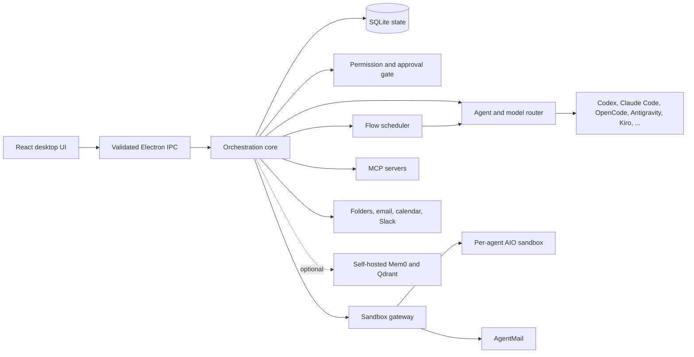

<div align="center">


# Conductor

*Plan, run, and review work across multiple AI coding CLIs, and run sandboxed agents and scheduled workflows, from one local-first macOS app*

[](https://github.com/mgm152002/Conductor/actions/workflows/quality.yml)
[](https://nodejs.org)
[](#requirements)
[](package.json)

[Features](#features) • [Getting started](#getting-started) • [Agents and flows](#agents-and-flows) • [How it works](#how-it-works) • [Development](#development) • [Security](#security-model)

</div>

Conductor is a local-first macOS desktop application for orchestrating AI agents. It keeps project context, permissions, task history, attachments, and agent routing in one interface, while leaving execution with the CLIs already installed on your machine. Agents that need to browse, run commands, or keep files work inside their own Docker sandbox.

> [!WARNING]
> Conductor is under active development. It is currently intended for local development and evaluation, not production deployment.

## Features

**Work**
- **Multi-agent routing**: send work to Codex, Claude Code, OpenCode, Antigravity, Kiro, Command Code, or a configured remote Codex host, with compatible fallback models on retry.
- **Planned execution**: break a task into dependency-aware steps and watch it run, with each conversation pinned to the agent and provider session that started it.
- **Permission gates**: read-only, assisted, or trusted profiles, with per-tool approval before commands, file changes, or wider access.
- **Attachments**: attach documents, images, and zip archives, preview them locally, and pass them to the CLI through its supported input.
- **Connected context**: pull project context from folders, IMAP email, iCalendar, and Slack.

**Agents**
- **Sandbox agents**: named agents that run on your CLIs, each with its own [AIO Sandbox](https://github.com/agent-infra/sandbox) container for a browser, shell, and files, behind the approval gate.
- **Persistent by default**: every agent keeps a private workspace volume, shares a common folder (with locks) with the others, and has a shared notebook, plus optional Mem0 memory (private and shared) filled from those volumes.
- **Browser logins that last**: each sandbox keeps its browser profile in its own volume, so a site you signed into survives the container being deleted.
- **Groups**: plan how several agents split a message, run them in order in one shared sandbox, and watch their browsers live.
- **Files back to you**: agents return PDFs, Word documents, zips, and more, opened in an in-app viewer.

**Flows**
- **Workflow canvas**: chain agent steps into a graph with parallel branches and joins, and run it by hand or on a schedule.
- **Describe it to build it**: type what you want and Conductor drafts the flow.
- **Per-step control**: pick the CLI, model, and effort each step uses.
- **Email in the loop**: agents write to you through [AgentMail](https://agentmail.to), and a *reply* step waits for your answer ("apply to all") before the flow continues.
- **Run history**: runs stay out of agents' chats and appear in their own history, with stop and run-again controls.

**Everywhere else**
- **MCP, installed once**: add an MCP server and Conductor writes it into every supported CLI's own config, then keeps them in sync.
- **Phone control**: drive Conductor from your phone over an ngrok tunnel.
- **Usage and quota**: see spend and remaining quota per CLI.
- **Local-first state**: durable state and provenance live in SQLite on your machine; semantic memory is optional through a self-hosted Mem0 + Qdrant service.
- **Self-improving routing**: routing preferences learned from finished tasks, applied only with your approval and easy to roll back.

## Requirements

- macOS (Apple Silicon for the prebuilt DMG)
- [Node.js](https://nodejs.org) 22 or newer and npm
- At least one supported agent CLI installed and signed in. Conductor finds CLIs on your `PATH`; sign-in stays with each provider
- [Docker Desktop](https://www.docker.com/products/docker-desktop/), for sandbox agents (the image is about 12 GB) and the optional Mem0 service
- Optional: an [AgentMail](https://agentmail.to) API key for email steps, and [ngrok](https://ngrok.com) for phone control

## Getting started

```sh
git clone https://github.com/mgm152002/Conductor.git
cd Conductor
npm ci
npm run dev
```

Open **Agents** and choose **Download sandbox** the first time, then create an agent and give it a task.

### Optional: local memory service

```sh
npm run mem0:configure
npm run mem0:up
npm run mem0:status   # npm run mem0:stop to stop it
```

See [docs/mem0.md](docs/mem0.md) for the storage model, credentials, migration, and recovery.

### Install from a release

Pushing a tag that matches `version` in `package.json` (for example `v0.5.0`) builds an arm64 DMG in CI and attaches it to a GitHub Release. To build it locally:

```sh
CSC_IDENTITY_AUTO_DISCOVERY=false npm run dist:mac
```

The DMG lands in `release/`. It is unsigned and not notarized, so macOS may say Conductor is damaged. Clear the quarantine flag and open it again:

```sh
xattr -cr /Applications/Conductor.app
```

## Agents and flows

### Sandbox agents

Each agent gets a container from the AIO Sandbox image, bound to `127.0.0.1` with a random key and started on demand. It stops after sitting idle. Three Docker volumes outlive the container:

| Volume | What it holds | Who sees it |
| --- | --- | --- |
| Workspace | the agent's own files | that agent only |
| Shared | a common folder and notebook, with lock tools | every agent |
| Browser profile | cookies and logins | that sandbox only |

A group chat or a flow works in the shared volume, so its members can hand files to each other. Deleting an agent deletes its own volumes; the shared one stays. Use **Clear logins** on a running sandbox to sign it out of every site.

### Flows

A flow is a graph of steps. Each step is either an agent step or a reply step.

- **Agent step**: runs an agent with a prompt, on the CLI, model, and effort you choose, and can use the output of the steps before it.
- **Reply step**: waits for your email reply (24 hours by default) and passes it on.
- **Schedule**: one or more times a day in local time. A run fires once if the app was closed at the time, and runs never stack.
- **One sandbox per flow**: all steps share a sandbox and its browser logins. Each run starts fresh and does not reuse files from earlier runs.
- **Email tools**: agents can send mail to the address you set, and only to that address. Replies arrive over AgentMail's WebSocket (a desktop app has no public address for a webhook), with a catch-up check for replies that came in while the app was closed.

The **internship** template is a ready-made example: find roles from a repository such as [SimplifyJobs/Summer2027-Internships](https://github.com/SimplifyJobs/Summer2027-Internships) using a prompt you edit, tailor a resume for each, upload them to Google Drive, email you the list, wait for your reply, then apply and send a report.

Limits to know about:
- Scheduled runs only fire while Conductor is open.
- A run waiting for a reply blocks new scheduled runs of that flow.
- Agents don't get past CAPTCHAs or human-verification checks; a step that hits one stops.

### MCP servers

Add a server once under **Connected apps → MCP Servers** and Conductor installs it into the config of each supported CLI (Claude Code, Codex, OpenCode, Antigravity, and Kiro), including servers that need headers or sign-in. Servers that need an `auth` step (such as Google Drive) must be signed in by you in a terminal; Conductor shows the command. New servers stay untrusted until you approve them. See [docs/mcp-oauth.md](docs/mcp-oauth.md) for device-flow providers.

## How it works



Electron's main process owns orchestration, storage, secrets, external connections, and CLI processes. The sandboxed renderer talks to it through a small preload bridge with validated IPC contracts. Agent tool calls pass through the sandbox gateway, which applies the permission checks, and tools that must not run in the sandbox (memory, email, saving a file to your Mac) are handled by the gateway itself.

More detail is in [docs/architecture.md](docs/architecture.md).

### Attachments

PDFs are rendered locally with macOS PDFKit and their text extracted locally, with on-device Vision OCR for pages that have none. Agents receive a manifest of the current turn's attachments plus the CLI's native input (`--image` for Codex, `--file` for OpenCode), and the renderer never sees filesystem paths. Limits: 10 files per message, 25 MiB per file, 250 MiB per message, 40,000 extracted characters.

## Development

```sh
npm run lint        # ESLint, zero warnings allowed
npm run typecheck   # TypeScript for main/preload and renderer
npm test            # Vitest suite
npm run build       # Production build via electron-vite
```

The [Quality workflow](.github/workflows/quality.yml) runs install, lint, typecheck, and tests on pushes and pull requests to `main`, then builds the macOS DMG as the `conductor-macos-dmg` artifact.

### Project structure

```text
src/main/       Electron main process: orchestration, adapters, sandbox, flows, storage, IPC
src/preload/    Sandboxed renderer bridge
src/renderer/   React desktop interface
src/shared/     Shared contracts, schemas, and domain types
services/mem0/  Optional self-hosted semantic-memory service
test/           Unit, integration, and UI-focused tests
docs/           Architecture and operational documentation
```

## Security model

- The renderer uses Electron context isolation and a narrow preload API; IPC inputs are validated before they reach main-process services.
- Credentials live in the macOS Keychain; only metadata is stored in SQLite. The AgentMail key is kept in a user-only file in the app's data folder.
- Sandboxes listen on loopback only, use a random key, and run behind the permission gate.
- Agents can email only the one address you configure, so a page an agent reads can't turn the inbox against someone else.
- Browser logins are stored per sandbox in Docker volumes on your Mac, and every step sharing a sandbox can use the accounts signed in there. Use a dedicated account for agents, not your main one.
- New MCP servers remain untrusted until explicitly approved.
- Source content and prior agent output are treated as untrusted reference data.
- Destructive or privileged agent actions are gated by the active permission profile.
