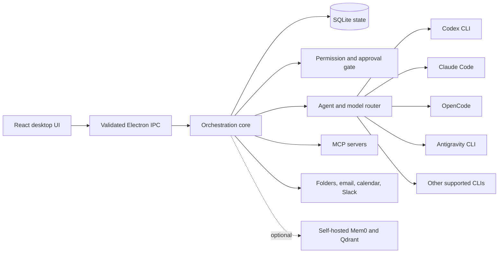

# Conductor

[](https://github.com/mgm152002/Conductor/actions/workflows/quality.yml)

Conductor is a local-first macOS desktop application for planning, running, and
reviewing work across multiple AI coding CLIs. It keeps project context,
permissions, task history, attachments, and agent routing in one interface while
leaving execution with the tools already installed on your machine.

> Conductor is under active development. It is currently intended for local
> development and evaluation, not production deployment.

## Architecture



Electron's main process owns orchestration, storage, secrets, external
connections, and CLI processes. The sandboxed renderer communicates through a
small preload bridge with validated IPC contracts. Agent tool calls pass through
permission checks before commands, file changes, or wider access are allowed.

## Highlights

- Plan tasks into dependency-aware steps and monitor live execution.
- Route work to Codex, Claude Code, OpenCode, Antigravity, Kiro, Command Code,
  or a configured remote Codex host.
- Keep conversations pinned to the originating agent and provider session.
- Retry compatible fallback models without leaking one CLI's model selection to
  another CLI.
- Attach documents and images to tasks, preview them locally, and deliver them
  to the selected CLI through its supported input mechanism.
- Apply read-only, assisted, or trusted permission profiles with per-tool
  approval prompts.
- Connect approved MCP servers and ingest project context from folders, IMAP,
  iCalendar, and Slack.
- Store durable workflow state and provenance locally; optionally add semantic
  memory through a self-hosted Mem0 service.
- Learn routing preferences from completed task outcomes, subject to user
  approval and rollback safeguards.

## Requirements

- macOS
- Node.js 22 or newer
- npm
- At least one supported agent CLI installed and authenticated
- Docker Desktop only if you want to run the bundled Mem0 service

## Development setup

```sh
git clone https://github.com/mgm152002/Conductor.git
cd Conductor
npm ci
npm run dev
```

Conductor discovers supported CLIs from `PATH`. Their sign-in and account setup
remain owned by the respective providers.

### Optional local memory service

```sh
npm run mem0:configure
npm run mem0:up
npm run mem0:status
```

See [docs/mem0.md](docs/mem0.md) for the storage model, credentials, migration,
and recovery behavior.

## Quality checks

```sh
npm run lint
npm run typecheck
npm test
npm run build
```

The [Quality workflow](.github/workflows/quality.yml) runs dependency
installation, linting, type checking, and the test suite for pushes and pull
requests targeting `main`.

## Attachments

PDFs are rendered locally with macOS PDFKit and text is extracted locally; when
a page has no embedded text, Conductor can use on-device Vision OCR. Pasted
images are stored through the same managed attachment flow and show a local
thumbnail. Chat and task agents receive an explicit current-turn attachment
manifest with bounded extracted/OCR text plus the appropriate native CLI input
(`--image` for Codex and `--file` for OpenCode). Rendered PDF pages offer page
navigation, zoom, and an extracted-text fallback without exposing filesystem
paths to the renderer.

Attachments remain capped at 10 files per message, 25 MiB per file, 250 MiB
per message, and 40,000 extracted characters. OCR/rendering stays on-device;
images pasted directly must be genuine supported image bytes.

## Project structure

```text
src/main/       Electron main process, orchestration, adapters, storage and IPC
src/preload/    Sandboxed renderer bridge
src/renderer/   React desktop interface
src/shared/     Shared contracts, schemas and domain types
services/mem0/  Optional self-hosted semantic-memory service
test/           Unit, integration and UI-focused tests
docs/           Implementation notes and operational documentation
```

## Security model

- The renderer uses Electron context isolation and a narrow preload API.
- IPC inputs are validated before reaching main-process services.
- Credentials are stored in the macOS Keychain; only metadata is stored in
  SQLite.
- New MCP servers remain untrusted until explicitly approved.
- Source content and prior agent output are treated as untrusted reference data.
- Destructive or privileged agent actions are gated by the active permission
  profile.

## Current limitations

- Gmail, Outlook, and Google Calendar integrations currently rely on app
  passwords or secret iCalendar URLs rather than OAuth.
- Workflow branches, loops, scheduled workflow triggers, and automatic
  retention cleanup are not yet executable.
- Some integrations are covered by automated fakes but have not been verified
  against live third-party services. See
  [the implementation status](docs/implementation/status.md) for details.

## License

This repository is currently unlicensed. All rights are reserved unless a
license is added later.
