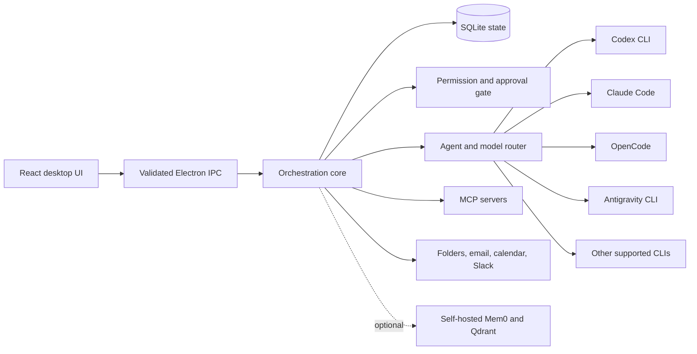

<div align="center">

# Conductor

*Plan, run, and review work across multiple AI coding CLIs — from one local-first macOS app*

[](https://github.com/mgm152002/Conductor/actions/workflows/quality.yml)
[](https://nodejs.org)
[](#requirements)
[](package.json)

[Features](#features) • [Getting started](#getting-started) • [How it works](#how-it-works) • [Development](#development) • [Security](#security-model)

</div>

Conductor is a local-first macOS desktop application for orchestrating AI coding agents. It keeps project context, permissions, task history, attachments, and agent routing in one interface, while leaving execution with the tools already installed on your machine.

> [!WARNING]
> Conductor is under active development. It is currently intended for local development and evaluation, not production deployment.

## Features

- **Multi-agent routing** — Route work to Codex, Claude Code, OpenCode, Antigravity, Kiro, Command Code, or a configured remote Codex host, with compatible fallback models on retry.
- **Planned execution** — Break tasks into dependency-aware steps and monitor live execution, with conversations pinned to the originating agent and provider session.
- **Permission gates** — Read-only, assisted, or trusted profiles, with per-tool approval prompts before commands, file changes, or wider access are allowed.
- **Attachments** — Attach documents and images to tasks, preview them locally, and deliver them to the selected CLI through its supported input mechanism.
- **Connected context** — Connect approved MCP servers and ingest project context from folders, IMAP email, iCalendar, and Slack.
- **Local-first state** — Durable workflow state and provenance are stored locally in SQLite; semantic memory is available optionally through a self-hosted Mem0 + Qdrant service.
- **Self-improving routing** — Routing preferences learned from completed task outcomes, subject to user approval and rollback safeguards.

## Requirements

- macOS (Apple Silicon for the prebuilt DMG)
- [Node.js](https://nodejs.org) 22 or newer and npm
- At least one supported agent CLI installed and authenticated — Conductor discovers CLIs from `PATH`, and their sign-in remains owned by the respective providers
- Docker Desktop, only if you want to run the bundled Mem0 service

## Getting started

```sh
git clone https://github.com/mgm152002/Conductor.git
cd Conductor
npm ci
npm run dev
```

### Optional: local memory service

```sh
npm run mem0:configure
npm run mem0:up
npm run mem0:status   # npm run mem0:stop to stop it
```

See [docs/mem0.md](docs/mem0.md) for the storage model, credentials, migration, and recovery behavior.

### Install from a release

Pushing a tag matching `version` in `package.json` (for example, `v0.2.0`) builds an arm64 macOS DMG in CI and attaches it to a GitHub Release of the same name. To build it locally:

```sh
npm ci
CSC_IDENTITY_AUTO_DISCOVERY=false npm run dist:mac
```

The DMG lands in `release/`.

> [!NOTE]
> The DMG is unsigned and not notarized, so Gatekeeper will warn on first launch. It is intended for local evaluation, not distribution.

## How it works



Electron's main process owns orchestration, storage, secrets, external connections, and CLI processes. The sandboxed renderer communicates through a small preload bridge with validated IPC contracts, and agent tool calls pass through permission checks before they run.

### Attachments

PDFs are rendered locally with macOS PDFKit and text is extracted locally; when a page has no embedded text, Conductor can use on-device Vision OCR. Pasted images are stored through the same managed attachment flow and show a local thumbnail. Chat and task agents receive an explicit current-turn attachment manifest with bounded extracted/OCR text plus the appropriate native CLI input (`--image` for Codex, `--file` for OpenCode), without exposing filesystem paths to the renderer.

Limits: 10 files per message, 25 MiB per file, 250 MiB per message, and 40,000 extracted characters.

## Development

```sh
npm run lint        # ESLint, zero warnings allowed
npm run typecheck   # TypeScript for main/preload and renderer
npm test            # Vitest suite (127 test files)
npm run build       # Production build via electron-vite
```

The [Quality workflow](.github/workflows/quality.yml) runs install, lint, typecheck, and tests for pushes and pull requests targeting `main`, then builds the macOS DMG as the `conductor-macos-dmg` artifact.

### Project structure

```text
src/main/       Electron main process: orchestration, adapters, storage, IPC
src/preload/    Sandboxed renderer bridge
src/renderer/   React desktop interface
src/shared/     Shared contracts, schemas, and domain types
services/mem0/  Optional self-hosted semantic-memory service
test/           Unit, integration, and UI-focused tests
docs/           Implementation notes and operational documentation
```

## Security model

- The renderer uses Electron context isolation and a narrow preload API; IPC inputs are validated before reaching main-process services.
- Credentials are stored in the macOS Keychain — only metadata is stored in SQLite.
- New MCP servers remain untrusted until explicitly approved.
- Source content and prior agent output are treated as untrusted reference data.
- Destructive or privileged agent actions are gated by the active permission profile.
